# Switchboard

A shared team inbox. Customers write to a business through a messaging provider
(Pigeon), support agents sign in, see conversations arrive live, claim them,
reply, and leave private notes for each other. Several workspaces share one
deployment and never see each other's data.

Stack: Node 22, Express 5, TypeScript, MongoDB, Redis, `ws`. The web app is
React + Vite.

## Run it

You need Node 22+ and Docker.

```
npm run up                  # MongoDB, Redis, Pigeon, IdP, Paybox in Docker
npm run scaffold:install    # server and web dependencies
npm run scaffold:server     # API on http://localhost:4000
npm run scaffold:web        # web app on http://localhost:5173
```

Open http://localhost:5173. Settings come from the environment; the defaults
match the local Docker services, so no `.env` is needed. `.env.example` lists
every variable. `GRADER_TOKEN` must be set explicitly when `NODE_ENV=production`.

No Docker: `npm run mocks` starts the simulators with plain Node, and
`MONGO_URL` / `REDIS_URL` can point at any MongoDB and Redis.

## Using the app

Customers are simulated by Pigeon. To make one write to you:

```
npm run inbound
```

**1. Sign in.** The app opens on a sign-in page.

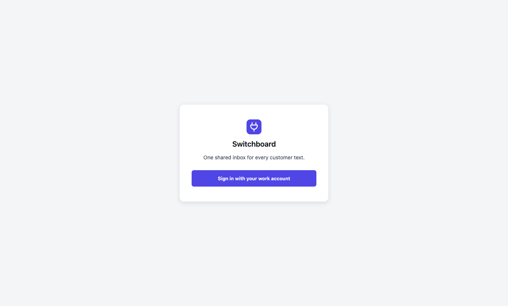

**2. Pick a test user.** The identity provider is a mock, so there are no
passwords: click a user. Ben Ortiz is an agent in `ws_acme`; Eli Novak belongs
to two workspaces and gets a workspace switcher.

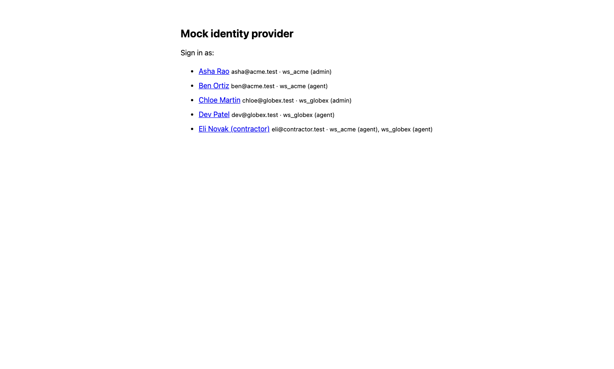

**3. The inbox.** Conversations are listed with the newest activity first.
Use the Open, Closed and Mine tabs to filter. Each row shows the last message
and who holds the conversation.

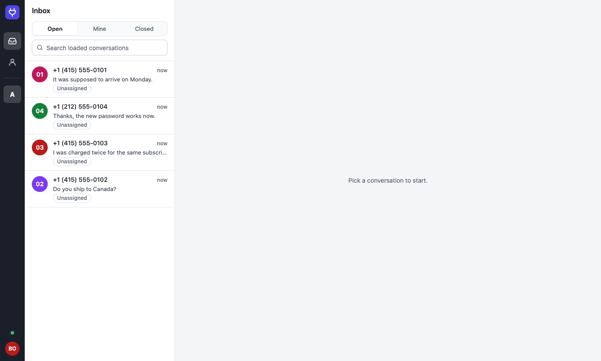

**4. Read a conversation.** Click a row. Customer messages are on the left, in
the order they were sent.

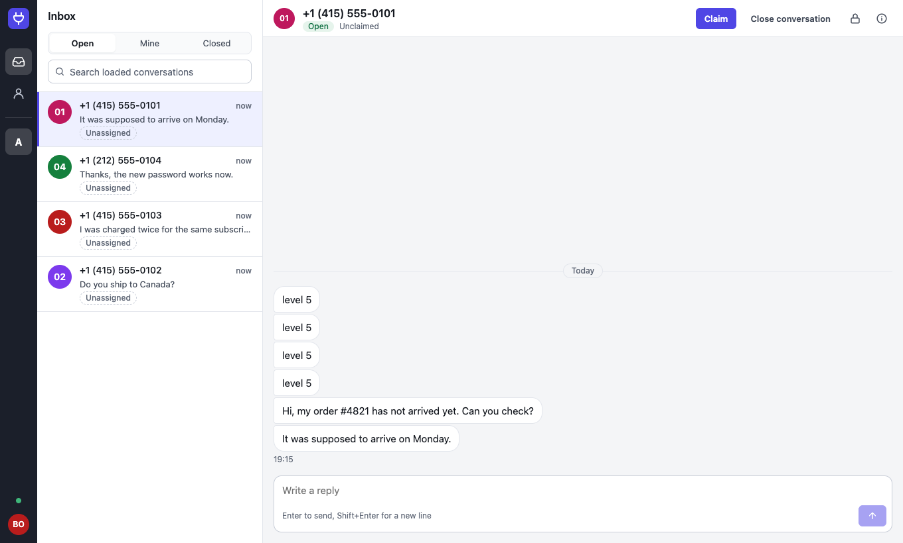

**5. Claim it and reply.** Claim puts your name on the conversation; nobody else
can claim it until you release it. Type a reply and press Enter. The message
shows its status as it goes: queued, sent, delivered (or failed).

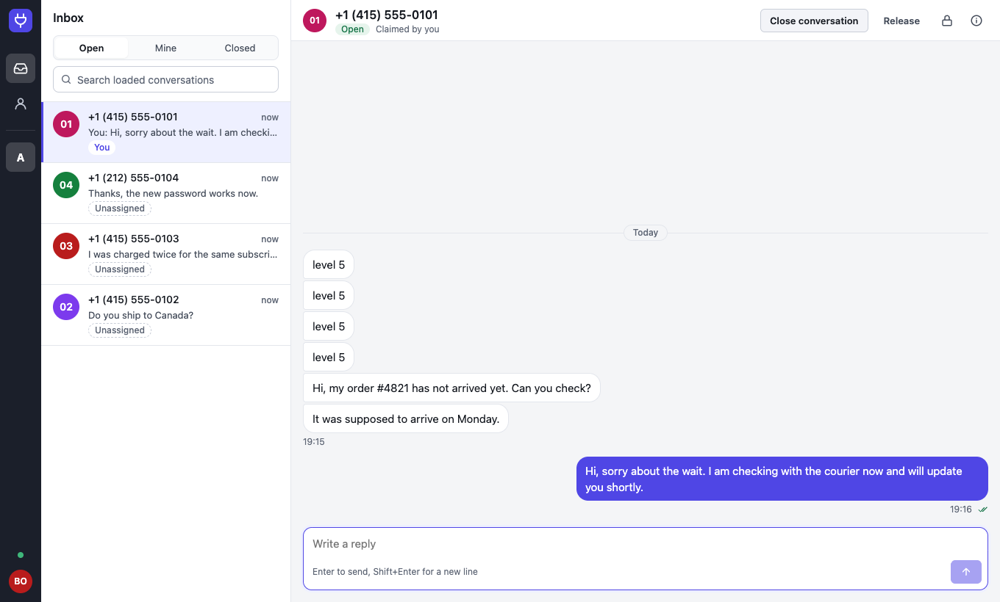

**6. Leave a private note.** Click the lock icon in the conversation header to
open the side panel and add a note. Notes are encrypted in the browser, so the
server stores text it cannot read. See `PROTOCOL.md`.

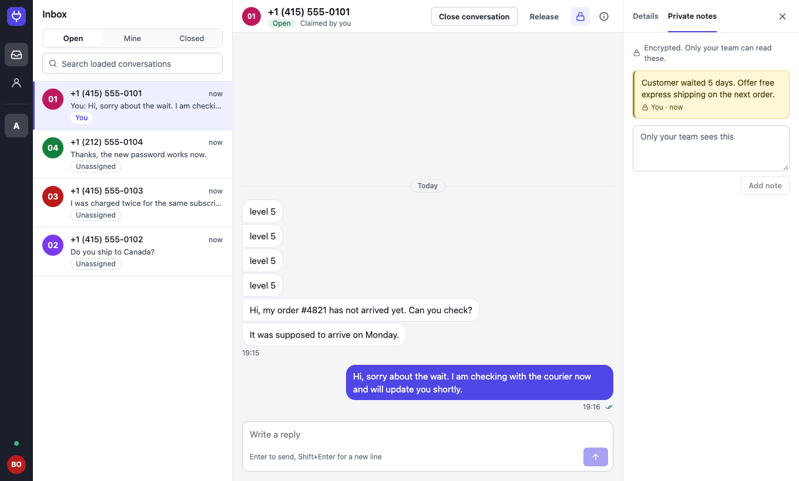

**7. Watch it update live.** When a customer writes, the list and the open
conversation update without a refresh. If the connection drops, the app
reconnects and catches up on what it missed.

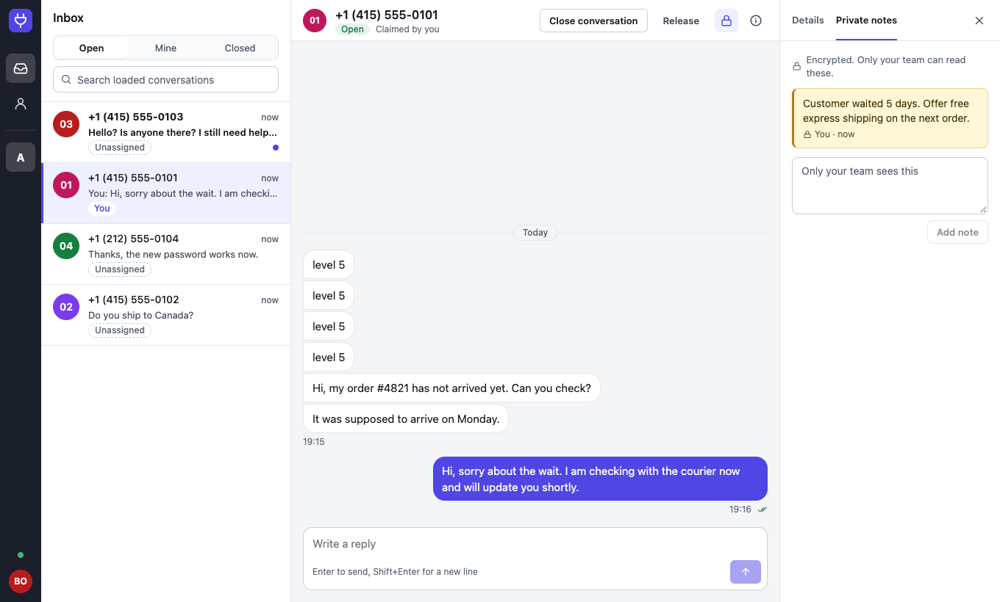

**8. Close a conversation.** Closed conversations move to the Closed tab. A new
message from the customer reopens them.

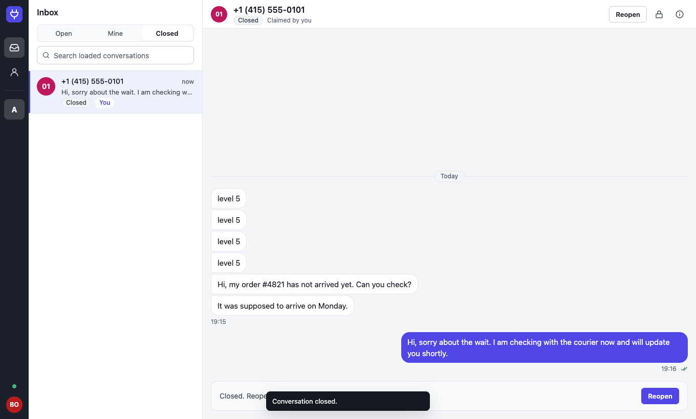

**9. Conversation details.** The info icon opens a panel with the number, owner,
status and how many messages there are.

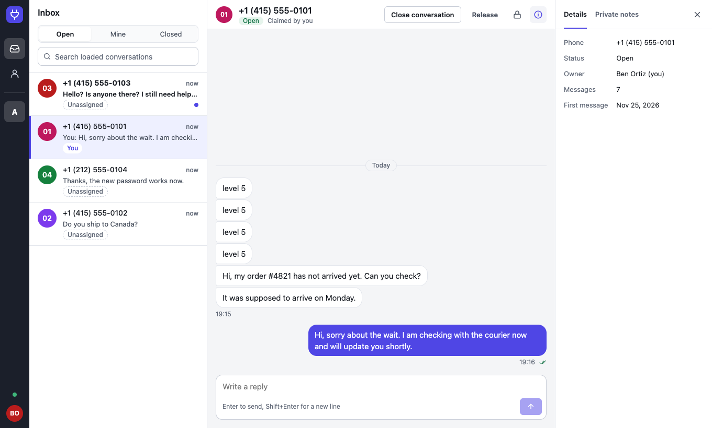

**10. On a phone.** Below 640 px the list and the conversation take turns on the
screen, with a Back button.

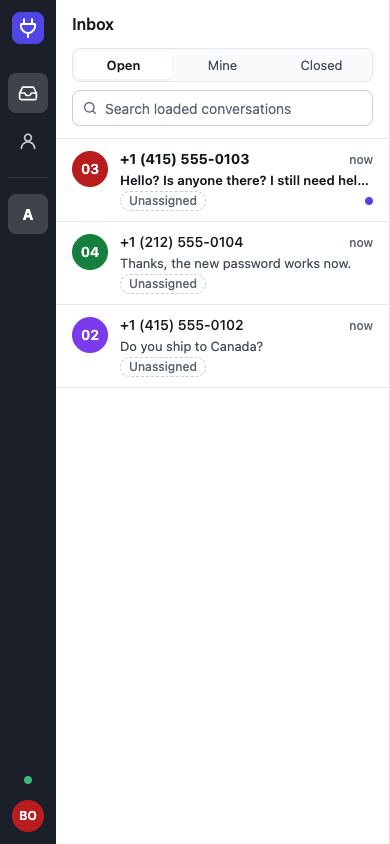 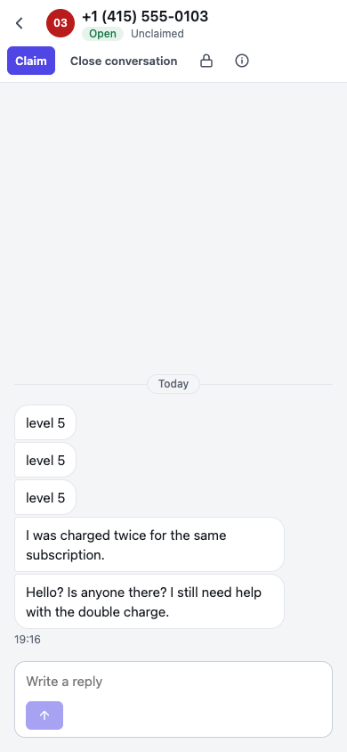

## Check and tests

```
npm run check               # level 1, about 90 s
npm run check:full          # levels 1, 2, 3 and 5, about 4 min, writes CHECK_REPORT.json
npm run check -- --levels 5
npm --prefix scaffold/server test    # 41 unit and integration tests (needs MongoDB and Redis)
```

The check starts the server itself (see `switchboard.json`), so stop your dev
server first. It wipes application data. The tests use a separate database
(`switchboard_test`).

`CHECK_REPORT.json` is the result of the last full run: 75 of 75 on levels 1, 2,
3 and 5. Level 4 (the written rules) is not part of the local check.

## How it is put together

```
Pigeon --webhook--> POST /webhooks/pigeon --> MongoDB (messages, frames)
                                                  |
                          Redis pub/sub  <--------+
                                |
browser <--WebSocket /ws--------+

agent reply --> outbox (MongoDB) --> sender loop --> Pigeon /v1/messages
```

- **Webhooks** (`routes/webhook.ts`): HMAC signature over the raw body, five
  minute window. A message is stored first and acknowledged after, so a
  crash makes Pigeon retry. Inserts are keyed on Pigeon's `message_id`, so
  duplicates collapse. Order is by `occurred_at`, not arrival.
- **Frames** (`lib/frames.ts`): every change a client may care about is a row
  with a per-workspace `seq`, written under a short Redis lock so rows commit
  in seq order. WebSocket clients read rows after their last seq, which is
  also how `?after=` replay works.
- **Replies** (`lib/outbox.ts`): a reply is a row in `outbox`, written before
  the request is answered. Any server copy can lease a due row (20 s lease),
  so work left by a dead copy is picked up by the others. Pigeon gets the
  `client_ref` as `Idempotency-Key`, which makes every retry safe.
- **Rate limit** (`lib/ratelimit.ts`): one token bucket per workspace in
  Redis, shared by all copies. A `429 Retry-After` or `503` pauses the
  workspace for everyone.
- **Claim** (`lib/conversations.ts`): one atomic upsert guarded by a unique
  index on `(workspace, contact)`, so only one agent can hold a conversation.
- **Login** (`lib/oidc.ts`, `routes/auth.ts`): authorization code with PKCE,
  the id_token is checked against the IdP's keys, the session lives in Redis.
  Every API call and the WebSocket check workspace membership.
- **Private notes** (`routes/notes.ts`, `scaffold/web/src/crypto.ts`): keys are
  made and used in the browser only; the server stores ciphertext.

## Layout

```
scaffold/server/src
  index.ts            wiring, health, shutdown
  config.ts           environment
  db.ts               collections and indexes
  ws.ts               WebSocket server
  routes/             webhook, auth, api, notes, grader (check endpoints)
  lib/                signature, frames, inbound, outbox, ratelimit,
                      conversations, oidc, session, cookies
scaffold/server/test  tests
scaffold/web/src      React app (components/, crypto.ts, keyring.ts, useSocket.ts)
harness/              the check (given)
pigeon/ idp/ paybox/  simulators (given)
docs/screenshots      images used above
```

`DECISIONS.md` has what was cut and what is still wrong. `PROTOCOL.md` describes
the notes encryption.
